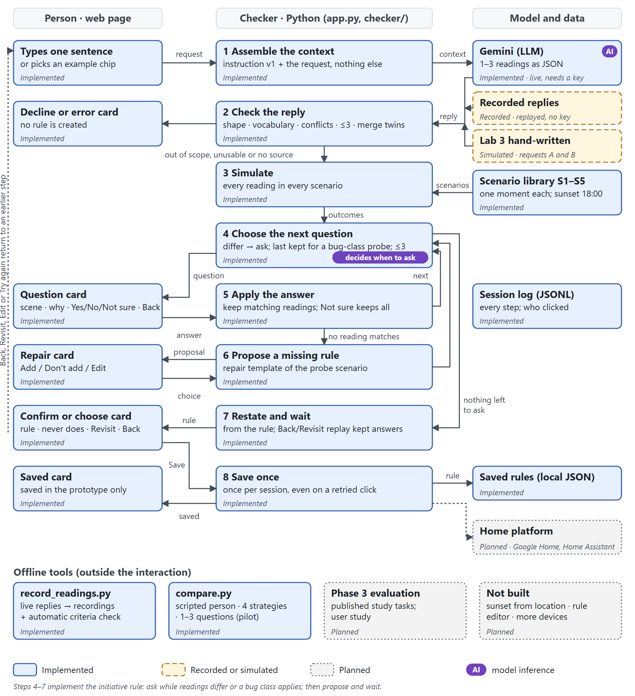

# Pre-save timing check for one-sentence home automations

*README prose: 1189 words (code, commands and file names not counted).*
Intelligent Interactive Systems, Assignment 2 (project Phase 2) · student 3189041 · submitted release `v1.0-a2`.

A person types one sentence, such as "Turn on the hallway light when I'm home after dark". Before saving, the
system asks up to three yes/no questions about concrete moments where Gemini's readings of the sentence differ or
where common rule bugs hide, proposes a missing rule when no reading fits an answer, and restates the rule,
including what it never does. Nothing is saved without Save.



## Project status

| Part | Status |
|---|---|
| Web page: Describe / Check / Save flow; question, repair, review, decline, error and saved cards | Implemented |
| Back and Revisit: return to an earlier step or reopen an answer, with later answers kept and replayed | Implemented |
| Checker: reply and conflict checks, simulator, question choice (at most three), repairs, restatement, log | Implemented, 46 tests |
| Gemini readings, live with your own key | Implemented |
| Gemini replies to the seven example requests, replayed without a key | Recorded 2 Nov 2026 (`gemini-3.5-flash`) |
| Lab 3 hand-written readings for requests A and B | Simulated; a fallback only |
| Offline comparison of question sources (`tools/compare.py`) | Implemented; pilot on my own intended behaviours |
| Saving to Google Home or Home Assistant, sunset from location, a rule editor, more devices | Planned |
| Phase 3 evaluation on published study tasks; a user study | Planned |

## Technology

- **Python 3.11, standard library only**: the server (`http.server`, threaded as in the Lab 4 app), the
  checker in `checker/` and the tests.
- **One web page** in plain HTML, CSS and JavaScript (`web/index.html`).
- **Gemini** (`generateContent` with a response schema), chosen for its free tier and JSON output. Undecided:
  which model a deployed version would use.
- **Node 26 and headless Microsoft Edge**, only for `tools/capture.mjs` (diagram and storyboard frames).
- No retrieval and no agent framework: one model call per request.

## Running or inspecting the work

```bash
py -3.11 app.py                  # or: python app.py   then open http://localhost:8000
py -3.11 -m unittest             # all tests, no network
py -3.11 tools/compare.py        # offline comparison of question sources
```

- Without a key, the example chips replay recorded Gemini replies; other sentences get a "no rule created" card.
- To use your own key, copy `.env.example` to `.env` and fill in `GEMINI_API_KEY` (Git ignores `.env`), then run
  `py -3.11 tools/record_readings.py --check`. Never commit a key.
- "How this was checked (for reviewers)", at the bottom of the page, shows what was sent to the model, its reply,
  the outcome table and why each question was chosen.
- Each run writes `logs/sessions.jsonl` (not committed); `driver` records whether a person or the capture
  script clicked.

## Development record

Each commit message says what changed, why, and how it was checked.

| Stage | What changed and why | Checked | Commits |
|---|---|---|---|
| A1 (Oct 2026) | Proposal: ask at most three questions where the model's readings differ, before saving. | | |
| Lab 3 (20 Oct) | Terminal prototype. Test B saved a rule that never turned the light off: both readings shared the error, so no question about a difference raised it. The revision added bug-class probes and a proposed "off" rule. | Saved transcripts | [`8286c88`](https://github.com/TINGHUI-HUANG/presave-timing-check/commit/8286c88) |
| Lab 3 crash | `sim.py` no longer ran: its help text reads the module docstring, which had been removed. | Output identical to the saved runs | [`96c7883`](https://github.com/TINGHUI-HUANG/presave-timing-check/commit/96c7883) |
| Rebuild | Split into `checker/` for the interface; scenario S5 added; identical readings merged. | Regression tests repeat Lab 3 | [`f4c9b8b`](https://github.com/TINGHUI-HUANG/presave-timing-check/commit/f4c9b8b) |
| Gemini | A live call with a versioned prompt replaced fixed readings; replies are recorded for replay. | Tests, including that the key never reaches the log | [`aa74484`](https://github.com/TINGHUI-HUANG/presave-timing-check/commit/aa74484) |
| Web page | Cards for each repair turn; the initiative rule in code. "light on (you said Yes)" contradicted the answer, so answers are now compared with outcomes. | Browser walk-throughs | [`de119ba`](https://github.com/TINGHUI-HUANG/presave-timing-check/commit/de119ba) |
| Recordings | `gemini-3.5-flash`, as older models are closed to new users; prompt v1 kept. | Six criteria, `docs/prompt_log.md` | [`86120dd`](https://github.com/TINGHUI-HUANG/presave-timing-check/commit/86120dd) [`ac33ade`](https://github.com/TINGHUI-HUANG/presave-timing-check/commit/ac33ade) |
| Probe fix | `compare.py` (the comparison A1 planned, as a pilot) showed probes wasted on conditions another rule covered; in E the missing "off" was never asked. Probes now apply only where the whole reading does nothing. | Exposed 8/9 → 9/9 deviations, correct rules 4/5 → 5/5, questions 13 → 10 | [`687dfbf`](https://github.com/TINGHUI-HUANG/presave-timing-check/commit/687dfbf) [`b191477`](https://github.com/TINGHUI-HUANG/presave-timing-check/commit/b191477) |
| Figures | Diagram and storyboards from code and real screens. Frames showed Yes and Save pre-focused (a default answer) and a decline claiming rules were drafted; both fixed. | Every frame looked at | [`f6f5197`](https://github.com/TINGHUI-HUANG/presave-timing-check/commit/f6f5197) [`b3819c3`](https://github.com/TINGHUI-HUANG/presave-timing-check/commit/b3819c3) |
| My changes | I added Back and Revisit (later answers kept and replayed), rejection of rules that switch the light on and off at once, merging only of fully equivalent readings, retry-safe actions with session recovery, and a new Describe / Check / Save interface with an illustrated scene for each question. | 12 new tests; all 46 pass | [`96b8933`](https://github.com/TINGHUI-HUANG/presave-timing-check/commit/96b8933) |
| Figures again | Storyboards recaptured for the new interface; storyboard 2 now shows Back. | Every frame looked at | [`fa6ba31`](https://github.com/TINGHUI-HUANG/presave-timing-check/commit/fa6ba31) |

## AI assistance

- **Claude Code** (Anthropic, Claude Opus 5.5, desktop app). I asked it to read the brief, my A1 review, my Lab 3
  work and the Week 1–4 slides, and to plan and build A2 with me. I approved its plan after adding two
  conditions: my Gemini key stays out of everything it writes, and it writes me a run guide in Chinese. It wrote
  the code, tests, prompt, figures, this README and the report draft, and ran and clicked through the app.
- **Gemini 3.5 Flash** proposes the readings at run time. It never sees the intended behaviours, and its replies
  pass the checks before anything reaches the screen. Only the example sentences were sent to it.

What I decided or checked myself:

- The topic, question and core design are from my A1 review; the Lab 3 revision was built with Claude Code and
  approved by me.
- I wrote the intended behaviours for C–E before any model output. I first ticked only "home since 17:00, dark at
  18:00" for all three; when Claude asked whether "as soon as I get home after dark" really meant no light on
  arriving after dark, I changed all three to "on whenever I am home and it is dark; off when I leave".
- I created `.env` myself. I first pasted Gemini's sample code, key included, into `.env.example`, which Git
  tracks; Claude checked that no commit contained it, and I restored the template and created `.env`. Claude never
  wrote the key into a file or command.
- I chose my GitHub name and Gmail address for the commits instead of the QQ address in my Git settings.
- I wrote commit `96b8933` by hand, without AI tools: Back and Revisit, the conflict check, stricter merging,
  retry-safe actions and session recovery, the new interface and 12 tests. Claude Code reviewed it, ran the 46
  tests and the comparison (results unchanged), recaptured the storyboards and committed it at my request.
- I ran the prototype myself on 2 Nov 2026 (sessions marked `browser`). For A, I said Yes to the light coming on
  at 18:00 when I had been home since 17:00, although my sentence only mentions arriving; I added the proposed
  sunset rule before saving. My door-lock request was declined twice with no rule created. For C, I added both
  proposed rules and saved. My own sentence, "Switch on the hallway light whenever it is dark and I am in", went to
  the live model, which refused with HTTP 429 (free quota used up); the page said no rule was created.

## Additional files

- `lab3/`: the Lab 3 prototype as imported, with its saved runs, diagrams and storyboard.
- `docs/`: diagram, storyboards and their screens, the comparison output and the prompt log.
- `tools/`: recording, comparison, diagram, capture, storyboard and word-count scripts.
- The report is submitted separately as a Word file; there is no ZIP.
