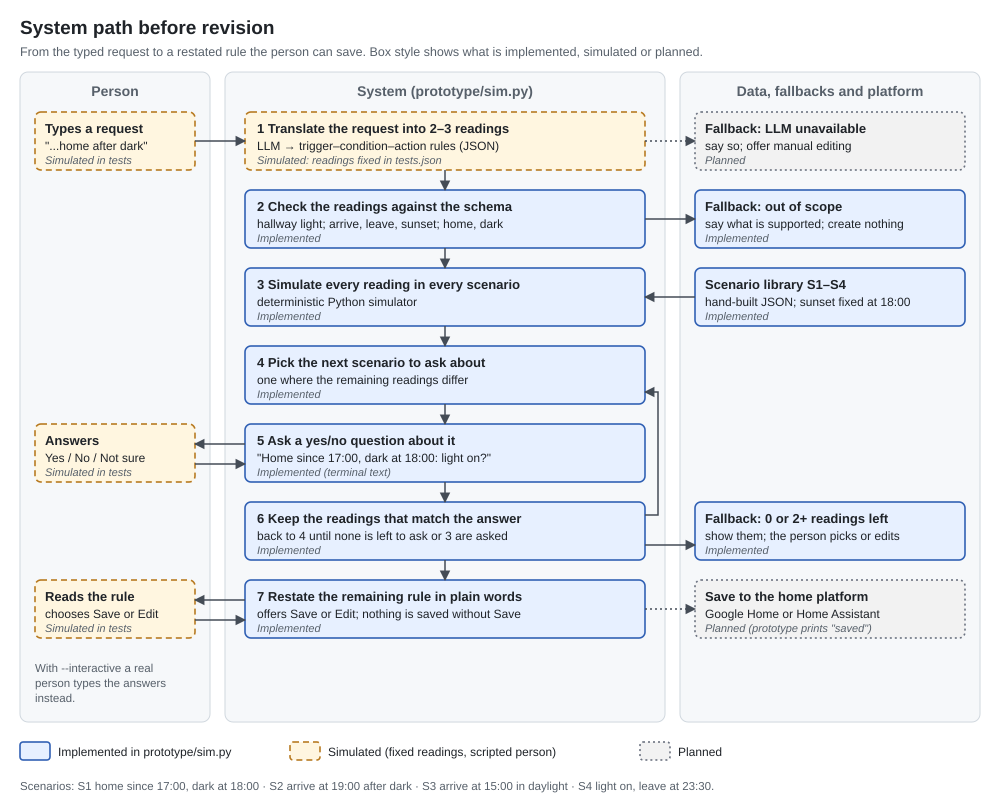
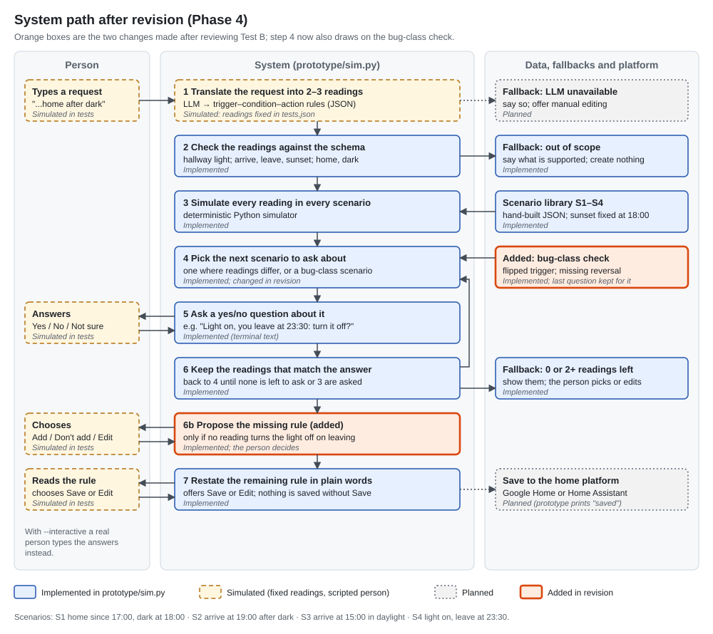

# 01_SPEC.md: use case and system path

**Use case:** checking when a generated home-lighting rule will act, before the person saves it.

## Starting point: storyboard

My Week 2 storyboard explored a different problem. I have since chosen the topic of my literature review, so this lab uses the use case that review proposes. 

In the Week 2 format:

- **Senses:** the typed request, the home's devices and events, the sunset time; later, the person's answers.
- **Infers:** which timing the person means, e.g. whether "when I'm home after dark" should also act at sunset if they are already home.
- **Does (channel):** asks up to three yes/no questions about concrete scenarios in the automation builder, then restates the chosen rule.
- **Feedback:** the restated rule, with Save and Edit.
- **Could be wrong when:** every reading shares the same error (for example, none turns the light off when the person leaves), so no question exposes it; or the person answers wrongly or is unsure.

## User goal

A person who does not program types one sentence to create a lighting automation. They want the hallway light on whenever they are home after dark, and want to find out before saving whether the generated rule will act at those times.

## System inputs

- **From the person:** the typed request; later, answers to scenario questions (Yes / No / Not sure) and the choice to Save or Edit.
- **Context the system receives:** the device and event schema (hallway light; events arrive, leave, sunset; conditions home, dark) and the day's sunset time (fixed at 18:00 in the prototype; planned: from the home's location).

## Processing and technology

| Step | What the system does | Technology | Status |
|---|---|---|---|
| 1 | Translates the request into 2–3 readings in a trigger–condition–action schema | LLM with structured (JSON) output | Simulated: readings fixed in `prototype/tests.json` |
| 2 | Checks that each reading uses only supported devices, events and conditions | Python | Implemented |
| 3 | Runs every reading through every scenario in a hand-built library (S1–S4) | Deterministic Python simulator; `prototype/scenarios.json` | Implemented |
| 4 | Picks the next scenario where the remaining readings differ (at most 3 questions) | Python | Implemented |
| 5 | Asks a yes/no question about that scenario | Terminal text | Implemented; the person's answers are scripted (simulated) |
| 6 | Keeps the readings that match the answer, then returns to step 4 | Python | Implemented |
| 7 | Restates the remaining reading in plain words; the person chooses Save or Edit | Python; home platform | Restatement implemented; saving to Google Home or Home Assistant planned |

## Intended result and next action

One rule restated in plain words, with Save and Edit. The person decides; nothing is saved without Save.

## Fallback strategy

- **Device missing from the request:** ask which device instead of guessing (planned).
- **Out of scope** (another device such as a door lock, or timing the simulator cannot model such as "within 2 hours"): say what the prototype supports and create nothing (schema check implemented).
- **"Not sure":** keep every reading and move to the next scenario (implemented).
- **No reading, or several, left after the questions:** show them side by side; the person picks, edits or rephrases (implemented).
- **LLM unavailable:** say so and offer manual editing; never invent a rule (planned).

## System path or interaction diagram

Solid boxes are implemented in `prototype/sim.py`, dashed boxes are simulated and dotted boxes are planned. The revised path is under Phase 4 below.

To run (Python 3, standard library only), from this folder: `python prototype/sim.py A` or `python prototype/sim.py B`; add `--revised` for the Phase 4 version and `--interactive` to answer the questions yourself. The runs below were saved with `--out runs/<name>.md`.

## Test A: standard input

Input: "When I arrive home after sunset, turn on the hallway light, and turn it off when I leave."

What the system receives: the request, the schema, sunset at 18:00, and one reading (simulated LLM output), R1: arrive and dark → on; leave → off.

What it does: the schema check passes. A single reading cannot differ from itself, so no scenario is selected and no question is asked.

Response and next action: "Here is the rule I will save: When you arrive home, if it is dark: turn on the hallway light. When you leave home: turn off the hallway light." [Save] [Edit]. The person saves. Offline check against the intended behaviour: no deviation. Full run: [runs/testA.md](runs/testA.md).

## Test B: problem input

Input: "Turn on the hallway light when I'm home after dark." The timing is vague. The intended behaviour, written before the run: on at sunset if already home, on when arriving after dark, off when leaving.

What the system receives: the request, the schema, sunset at 18:00, and two readings (simulated LLM output, from Figure 1 of my review draft): A, arrival only; B, arrival or sunset. Neither turns the light off.

What it does: the readings differ only in S1 (home since 17:00, dark at 18:00: A off, B on), so S1 is the only question. In S4 (light on, leave at 23:30) both leave the light on, so S4 is not asked.

Response and next action: Q1 "You have been home since 17:00. At 18:00 it gets dark. Should the hallway light come on at 18:00?" Yes → keeps B, drops A → "Here is the rule I will save: When you arrive home or it gets dark, if you are home and it is dark: turn on the hallway light." [Save] [Edit] → Save. Offline check: the saved rule leaves the light on after the person leaves at 23:30, and no question raised it. Full run: [runs/testB_before.md](runs/testB_before.md).

## Review and revision

### Phase 3: review of Tests A and B

| Question | Evidence | Problem |
|---|---|---|
| Did it make clear what it can and cannot do? | Both runs open with "I can preview rules for the hallway light that use arriving, leaving and sunset (sunset 18:00)." | None found. |
| Did it show what it understood? | Test B restates reading B: it says when the light turns on, but nothing about turning it off. | What the rule does not do stays invisible. |
| Did it ask for missing information instead of guessing? | Test B: S4 was not asked because A and B agree there; the saved rule never turns the light off, against the intended behaviour. | It guessed "never off" without asking. **Chosen problem.** |
| Could the person correct a wrong decision? | The only answers are Yes / No / Not sure; adding "off when I leave" needs Edit after the restatement. | No correction route at the question. |
| Did it keep the person in control of the next action? | In both tests nothing was saved until the person chose Save. | None found. |
| Did it respond honestly when a model was unavailable? | Not tested: the LLM step is simulated. | Only a planned fallback. |

### Phase 4: revision and retest

**Problem (from Test B):** the system asked only where the readings differed, so an error both readings shared, never turning the light off, was saved without a question.

**Interaction change:** ask about leaving home. When the answer matches no reading, propose the missing rule ("When you leave home: turn off the hallway light.") with Add / Don't add / Edit. The rule is proposed, not added automatically.

**Technology change:** step 4 gets a second source of scenarios, a bug-class check on the readings' structure. It covers the two bug classes that cut correct outcome predictions by about 22 percentage points in Brackenbury et al. (2019): flipped triggers (the rule fires on an event, such as arriving, where the person may mean a state, such as being home; raised by S1) and missing reversals (the rule turns the light on but never off; raised by S4). The three-question budget is shared: scenarios where the readings differ come first, and the last question is kept for a bug-class scenario. A repair template supplies the proposed "off" rule.

**Updated diagram:**

**Test B again** ([runs/testB_after.md](runs/testB_after.md)): Q1 (S1, readings differ) → Yes → keeps B. Q2 (S4, bug-class check: missing reversal) "The hallway light is on. You leave home at 23:30. Should the hallway light turn off when you leave?" → Yes → no reading matches → the system proposes the "off" rule → Add → the restated rule now has both parts → Save. Offline check: no deviation; S4 was raised before saving.

**Test A again** ([runs/testA_after.md](runs/testA_after.md)): one extra question (S1, flipped trigger), answered No; the saved rule is the same. The change costs a question even for a clear request.

**Why the changes help:** questions chosen only where readings differ cannot raise an error that every reading shares; the bug-class check starts from the rule's structure instead, so in Test B it raised the missing reversal before saving. The person stays in control, choosing Add, Don't add or Edit, and nothing is saved without Save. The cost is one extra question in Test A, so within a three-question budget a bug-class scenario can take the place of a divergence question.

**Still simulated or planned:** the LLM readings (fixed), the person (scripted answers) and saving to a platform; the bug-class tags on S1 and S4 were assigned by hand.

## Reference

Brackenbury, W. et al. (2019) 'How users interpret bugs in trigger-action programming', *Proceedings of the CHI Conference on Human Factors in Computing Systems (CHI '19)*. doi:10.1145/3290605.3300782.
